# Pokémon Crystal Crunch

> **Disclaimer:** Generative AI was used as a code assistant for some systems programming. All art/maps/dialogue (and everything creative) was made by myself and the community or was commissioned from real artists.

This is a hack of Pokémon Crystal meant to make you smile. All systems were designed with a pre-Gen 3 mindset. Other hacks already port new features like abilities, new moves, new items, etc. into Crystal (and do it incredibly well), so I don't see a reason to tread the same ground. There are exceptions to this rule when it comes to QoL - for example, the storage system now uses the Gen 3 UI.

## Status

Still in playtesting. Don't be surprised if you find bugs! Future updates may break existing saves.

## Download

Get the `.bps` patch from the [latest release](https://github.com/joseph-bayer/crystal-for-friends/releases/latest) and apply it to your own Pokémon Crystal ROM. See [How do I patch the game?](#how-do-i-patch-the-game) for the steps.

## Screenshots

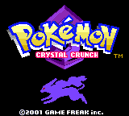
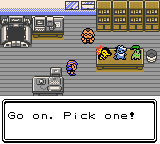
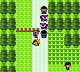
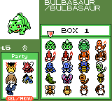
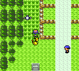
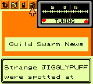
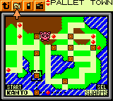
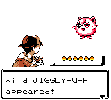
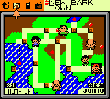
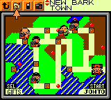
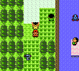
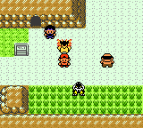
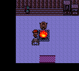
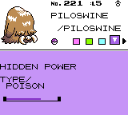
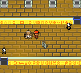
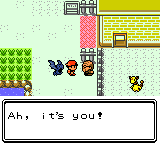
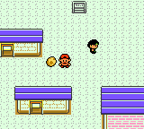
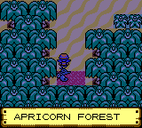
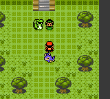
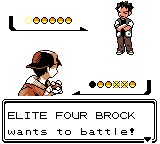

## Features

### All 251 Pokémon
- Where to find the legendaries is in [spoilers.md](spoilers.md).

### Following Pokémon
- Press **Select** on a party member to make it your follower.
- A fainted follower waits in its Poké Ball, and comes back out when you heal it.
- Eggs can follow you too!

### Wild Pokémon in the Overworld
- Many routes and towns have Pokémon wandering in the open.
- Walk into one, or face it and press **A**, to start a wild battle.
- What you see is what you fight - a shiny out in the grass is shiny in the battle.
- They are worth chasing: better DVs, far more likely to be holding an item, and better shiny odds than the same Pokémon in the grass.
- Some know egg moves or otherwise unobtainable moves.
- A chime plays when you walk into an area that has a shiny in it.
- Who turns up is decided fresh each time you enter an area, so it is worth passing back through.

### Swarms
- Daily swarms are announced via the radio on station 12.5, the Collection Guild's swarm report. Kanto swarms start after beating the Elite Four.
- Strange looking Pokémon potentially from the past?
- Team Rocket's Pokémon, left behind as you complete the story, swarm the routes. They all know Thief: one holding nothing can steal your Pokémon's item, which you only get back by catching it.
- Up to three swarms can be going at once: Arnie's and Anthony's phone calls still start theirs (Yanma on Route 35, Dunsparce in Dark Cave), and a new radio station picks one more every day.
- Swarms end at midnight.
- The radio won't announce the same swarm as either of the last two days you played.
- A swarm takes over about 60% of a route's grass or surf encounters, at the route's own levels.
- Heightened shiny chance (see [What are the shiny rates?](#what-are-the-shiny-rates)).
- Swarm Pokémon replace some overworld Pokémon on the route. Battle one and all of the route's wandering Pokémon are rolled again, to increase the chance of finding shinies.
- Active swarms are marked on the Pokégear map and the Fly map. When icons share a spot, they take turns showing.

### Roaming Legendaries
- Roaming legendaries appear in the overworld now instead of in the grass.
- The location of the roaming legendaries can be tracked on the Pokégear map immediately after the Burned Tower event.
- A roaming legendary stays put while you're on its route, so you can walk up to it. It only moves on when you leave, or after you battle it.
- Check [What are the shiny rates?](#what-are-the-shiny-rates) for updates to shiny mechanics surrounding the roaming legendaries.

### Cosmetic Forms
- Many Pokémon have new cosmetic forms - see the [screenshots](#screenshots), or [spoilers.md](spoilers.md) for where to find some of them.
- *Note:* Some forms will have a symbol that displays on the battle and stats screen to indicate that they're different. Not all forms will have this.

### Hidden Power
- Every Pokémon's Hidden Power attack power can be increased via various methods. The attack power starts at **20** and caps at **70**. Unown cap at **120**.
- Every 256 steps a Pokémon's Hidden Power attack power can go up via the following methods:
  - Pokémon holding a new item, the **GLYPH SHARD**, get a 25% chance to increase their power.
    - The GLYPH SHARD can be found as a rare item on wild Unown.
  - If an Unown is in the party, every Pokémon in the party gets a 25% chance to increase their power.
- Hidden Power can be Physical or Special, depending on which of its user's stats is higher (no longer dependent on type).
- **The Shaman**: based on the TCG card art for Desert Shaman illustrated by Kagemaru Himeno.
  - She unlocks a 4th stats page showing each Pokémon's Hidden Power type and level.
  - She gives you your first GLYPH SHARD.
  - She teaches Hidden Power for free, any time.

### The Open League
- Once you hold all 16 badges, the Elite Four opens up: every run is a new, random lineup of four Elite Four members and a Champion.
- The lineup is drawn from the Elite Four, the Johto and Kanto Gym Leaders, Lorelei and Agatha from Red and Blue, and a few surprises.
- Kanto Gym Leaders tell you they're joining right after you beat them.

### Pokégear
- Press **Select** on the Pokégear map or the Fly map to switch what the map shows:

  | View | Shows |
  |---------|-------------------|
  | SWARMS | Active swarms and roaming legendaries |
  | REMATCH | Trainers who are ready for a rematch |
  | GIFTS | Trainers who have an item waiting for you |

- When there are more trainers than fit on screen, they take turns showing.
- Press **Start** to slide over to the other region's map, once you've visited Indigo Plateau. On the Fly map, **Left** and **Right** still work too.

### Phone
- No more full phone: you can register every trainer who offers you their number.
- Trainers offer their number right after you beat them.
- Answer or decline calls: press **A** to answer, **B** to decline. Mom, Prof. Oak, Bill and Prof. Elm can't be declined.
- Fewer filler calls: trainers are more likely to call about a rematch or a gift.
- A trainer with a rematch or gift waiting won't call again until you go see them.

### HMs
- More Pokémon can learn the HMs, Rock Smash and Headbutt, following Polished Crystal's and Sour Crystal's learnsets. For example, Zubat and Golbat can learn Fly.
- You can use an HM outside of battle if a Pokémon in your party can learn it, as long as you have the HM in your bag. It doesn't have to know the move.
- Rock Smash works the same way once you've received its TM, even if you've since taught it.
- Headbutt still has to be known.
- HM moves can be forgotten like any other move, and Pokémon that know them can be released.
- Fly from the Pokégear map: press **A** on a town you've visited. The Pokémon that would fly is shown on the town.
- In a dark area, press **A** to prompt Flash.

### Daily Events
- The Bug Catching Contest now appears on Sundays as well (on top of Tuesdays, Thursdays, and Saturdays).
- A Sailor in Cianwood will take you to a mystery island once a day, where you can find new places to explore, rare Pokémon, and more.
- Once a day, find rare variants in swarms by tuning into radio channel 12.5.
- Mystery Gift with various NPCs once per day for rare items.

### Mystery Gift
- Improved rarity distribution - uncommon, rare, and super rare items appear more often.
- Upgraded rewards - all evolution items can be obtained by Mystery Gifting with NPCs.
- Locations
  - Carrie (Goldenrod Dept. Store 5F)
  - Kim (Blackthorn City)
  - Charlie (Silph Co. 1F)
- Limit once per day, per NPC.

### Breeding
- Fewer step cycles required to hatch eggs.
- Updated "hatching soon" and egg animation logic to scale down with the lower overall cycles.
- Eggs have blue spots when shiny.
- Eggs that will hatch into Elekid have their own pattern.
- The Day-Care Man stands outside the fence when an egg is ready.
- Hatched Pokémon show a Poké Ball as the ball they were caught in.
- Updated the Route 34 map to remove the grass patch in the egg hatching path.
- The Odd Egg's odds of each kind of Pokémon are more even.
- Removed the trainer ID penalty (same trainer IDs no longer reduce egg generation chance).
- Simplified and improved egg generation rates:

  | Pokémon Pairing | Egg Generation Chance |
  |-----------------|-----------------------|
  | Same species | 50% |
  | Different species | 25% |

### Type Rebalance
- Dark-type moves are now Physical.
- Ghost-type moves are now Special.
- Dragon-type moves are now Physical.

### Scaling Marts
- Town Poké Marts sell better stock as you earn badges (new stock at 2, 4, 6, and 8 badges), so going back to an early town doesn't mean worse shopping.
- A few towns keep a specialty item: Charcoal in Azalea, Surf Mail in Olivine and Cerulean, LiteBlueMail in Vermilion.
- Blackthorn's mart, the department stores, and specialty shops keep fixed stock; Blackthorn and the department stores sell TMs.

### Caught Ball
- The ball that a Pokémon is caught in is displayed on the stats screen.

### Wild Held Items
- Wild Pokémon are more likely to hold items:

  | Common Item | Rare Item |
  |----------------|-------------------|
  | **40%** *(+17%)* | **10%** *(+8%)* |

### Fleeing
- Only roaming legendaries flee wild battles.

### Headbutt Trees
- Headbutting a headbutt tree always results in a Pokémon appearing.
- Each area type has one encounter table instead of a common and uncommon table.

### Misc.
- Kurt makes Apricorn balls instantly, and can make several at once.
- Turn around after healing in the Pokémon Center so you don't accidentally heal again.
- Minor update to Goldenrod's layout so it's easier to get to the underground and the bike shop.
- The Bug Catching Contest is rebalanced, and includes overworld encounters.
- Happiness
  - Happiness goes up by 2 points every other step cycle instead of 1.
  - Leveling up, haircuts, Daisy's grooming, and battling Gym Leaders give more happiness.
- Simplified the clock reset
  - Hold **Down + B + Select** at the title screen, then confirm.

---

## Goals
- A larger variety of forms and swarms
- A larger variety of Mystery Islands to visit on a daily basis
- A larger variety of trainers in the Open League
- An improved Dex
- Additional trainers and locations in Kanto
- Customization of trainer color
- Enhanced tilesets and sprites
- An large assortment of new systems and QOL improvements

---

## FAQ

### How do I patch the game?

1. Download `crystal-crunch-<version>.bps` from the [latest release](https://github.com/joseph-bayer/crystal-for-friends/releases/latest).
2. You need your own unmodified **Pokémon Crystal (USA, Europe) (Rev 1)** ROM, also called version 1.1. Its SHA1 is `f2f52230b536214ef7c9924f483392993e226cfb`.
3. Open [ROM Patcher JS](https://www.marcrobledo.com/RomPatcher.js/) in your browser. It works on a computer or a phone, with nothing to install. Choose your ROM, then the `.bps`, and click **Apply patch**. It saves the patched game as a new `.gbc` file.
4. Load the patched `.gbc` in an emulator (see below).

If the patcher says the ROM is wrong, it's a different version (such as 1.0) or it has been modified.

The release's `.patch` file is a 3DS Virtual Console patch for trading and battling over Wi-Fi. Bundle it with your patched `.gbc` into a `.cia` using [poke-cia](https://github.com/vulcandth/poke-cia).

### Which emulator should I use?

This hack relies on the Game Boy Color's real-time clock (daily swarms, Mystery Gift, the Bug Catching Contest) and its double-speed mode, so use an accurate emulator.

**Recommended**
- **PC:** [BGB](https://bgb.bircd.org/), [SameBoy](https://sameboy.github.io/) or [mGBA](https://mgba.io/)
- **Android:** RetroArch with the SameBoy, mGBA or Gambatte core (not the VBA-M core)
- **iOS:** [SameBoy](https://sameboy.github.io/)

**Avoid**
- **VBA / VBA-M**: inaccurate and known to break modern hacks
- **MyOldBoy** (Android): doesn't handle the real-time clock correctly
- **Goomba Color** (GBA flash carts): can't run Crystal

If you hit a bug, please mention which emulator you're using when you report it.

### What are the shiny rates?
- Shiny Pokémon are no longer tied to specific DV spreads.
  - Unown can be shiny in any form - not just "I" and "V".
  - You can get shinies that are super weak, super strong, and everywhere in between.
- A shiny symbol appears below the Pokémon's name when it's shiny.
- Eggs are blue when shiny.
- Standard odds **1/8192**
- Gift Pokémon **1/512**
- Swarm Pokémon **1/512**
- Starters
  - In Elm's lab the three starters stand on the table. All three are rolled at once when you walk in, at **1/512** each, and are visibly shiny. Save before entering to hunt for a shiny starter!
- Bug Catching Contest **1/512**
- Odd Egg **always shiny**
- Eggs

  | Parent Shininess | Odds |
  |------------------|------------|
  | No shiny parents | **1/4096** |
  | One shiny parent | **1/64** |
  | Two shiny parents | **1/32** |

- Roaming legendaries
  - When the beasts are first seen in the Burned Tower, they will each have a **1/512** chance of appearing as shiny (and will remain shiny as they roam). This makes them soft-resettable all at the same time.
  - After that, every time one turns up on the route you're on, it has another **1/512** chance to be shiny.
  - Once you see a shiny roaming Pokémon in the overworld, it will remain shiny for all subsequent encounters. You do not need to actually encounter it in battle for this to happen.

---

## Code Credits
- **Pret.** None of this is possible without all the work the pret community has put into the pokecrystal dissasembly.
- **Built upon the CrystalShireEngine.** CrystalShireEngine is responsible for a multitude of engine improvements, bugfixes, and quality of life improvements (including the new box system!). Please review their [README](https://github.com/fellowship-of-the-roms/CrystalShireEngine) to see all the amazing things CrystalShireEngine provides.
- **Rebalances and some features based on Crystal Legacy.** Credits: [Crystal Legacy Team](https://github.com/cRz-Shadows/Pokemon_Crystal_Legacy)
  - Trainer Teams
  - Dynamic teams for CHUCK, PRYCE, and JASMINE depending on the order you face them in
  - Wild Encounters
  - NPC Trades
  - Fossils
  - Celebi Event
  - Game Corner Prizes
  - TM shops
  - Updated Evolution methods
  - Level-up learnsets
  - TM/HM learnsets
  - Reduced hatch cycles
  - Hatch Cycles
  - Move updates
- Parts of the [Add a new party menu icon](https://github.com/pret/pokecrystal/wiki/Add-a-new-party-menu-icon) tutorial were used and modified for cosmetic form party menu/daycare overworld/box icons. Credits to [Rangi42](https://github.com/Rangi42) for writing the original tutorial and [Cherryello](https://github.com/Cherryello), [mid-kid](https://github.com/mid-kid), [aaaaaa123456789](https://github.com/aaaaaa123456789), [Idain](https://github.com/Idain), [FrenchOrange](https://github.com/FrenchOrange), [SonicRay100](https://github.com/SonicRay100), and [Brianum](https://github.com/Brianum) for their updates to it.
- Follower Pokémon code by [Vulcandth](https://github.com/vulcandth) and [AtmaBuster](https://github.com/AtmaBuster).
- The simplified clock reset follows the [Simplify the Clock Reset Procedure](https://github.com/pret/pokecrystal/wiki/Simplify-the-Clock-Reset-Procedure) tutorial by [SonicRay100](https://github.com/SonicRay100) from the pret/pokecrystal wiki.
- The Hidden Power stats page follows the [Add a fourth stats page](https://github.com/pret/pokecrystal/wiki/Add-a-fourth-stats-page) tutorial by [Rangi42](https://github.com/Rangi42) from the pret/pokecrystal wiki.
- Trainers offering their number right after battle follows the [Improve the trainer rematch system](https://github.com/pret/pokecrystal/wiki/Improve-the-trainer-rematch-system) tutorial by Grate Oracle Lewot from the pret/pokecrystal wiki.
- Kurt making Apricorn balls instantly follows the [Kurt Makes Pokeballs Instantly](https://github.com/pret/pokecrystal/wiki/Kurt-Makes-Pokeballs-Instantly) tutorial by [Nayru62](https://github.com/Nayru62) from the pret/pokecrystal wiki (adapted from [Polished Crystal](https://github.com/Rangi42/polishedcrystal)), with the fade back in from [Sour Crystal](https://github.com/SoupPotato/sourcrystal).

### Polished Crystal
Ported from or based on [Polished Crystal](https://github.com/Rangi42/polishedcrystal):
- Untying shininess from DVs (partially based on its implementation)
- The new shiny check algorithm
- Using HMs without knowing them, Fly from the Pokégear map, the Flash prompt and the Ilex Forest HM texts
- The unlimited phone contact list, evening rematch times and the one-byte special phone call fix
- More Pokémon able to learn the HMs, Rock Smash and Headbutt

### Sour Crystal
Ported from or based on [Sour Crystal](https://github.com/SoupPotato/sourcrystal):
- Move and battle animations
  - One line isn't enough for how much work has been put into these animations. They truly make battles feel much more exciting.
- Answering or declining phone calls
- More Pokémon able to learn Rock Smash, and Zubat and Golbat able to learn Fly

## Art Credits
- **SCMidna**
  - Surfing Pikachu front sprites
- **bloodless**
  - Flying Pikachu back sprite
  - Flying Pikachu front sprites, with Kuroko Aizawa and metalflygon08
- **Kuroko Aizawa** and **metalflygon08**
  - Flying Pikachu front sprites, with bloodless
- **Sage**
  - Golbat, Arbok, Charmeleon, Charizard, Crobat and Electrode sprites used by Rockets. Colors modified from original.
  - Weezing sprite
- **Kester Henrick**
  - Blackbelt overworld sprite used for Karate Master
- **[FrenchOrange](https://github.com/FrenchOrange)**
  - Lorelei's and Agatha's trainer sprites
  - Help with the Shaman's overworld sprite
- **MauveSea**
  - Giovanni's trainer sprite
- **[Polished Crystal](https://github.com/Rangi42/polishedcrystal)**
  - Unown party menu icons. I could not find specific artist credits for these icons. If you made them, please let me know and I'll update this!
  - Campfire sprite and fire-pit tiles in the Shaman's house
- **[Sour Crystal](https://github.com/SoupPotato/sourcrystal)**
  - Most Pokémon party menu icons
  - New and redrawn move animation graphics
- **Game Freak**
  - The truck at Vermilion Port, from Pokémon Red and Blue, via [pret/pokered](https://github.com/pret/pokered)
